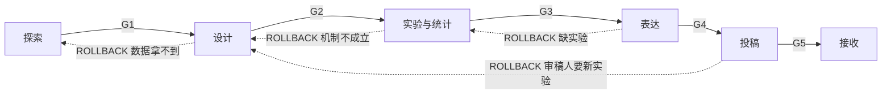

# Trellis

科研全流程状态机。**四张逻辑图**（§2）+ **五道闸门**（§8）+ **三段回流**（§3）+ **一个证据库**（§5.7）。

## 0. 使用说明

**判据速查**：gap §2.4 · 统计 §5.4 · 引用 §6.4 · 闸门 §8 · 回流 §3.3。每次动手前先读 §1 与 §3。

### 0.1 入口路由

用户不一定从阶段一开始。按下表定起点，不按用户措辞字面理解。

| 用户状态 | 起点 | 前置动作 |
|---|---|---|
| 不知道做什么 | §4.1 | — |
| 有方向，要评估 | §4.5 | — |
| 有 idea，要设计 | §5.1 | 先补轻量 Topic Brief + I-Graph |
| 数据跑完了 | §5.4 | 先做数据体检 |
| 要写论文 | §6.1 | 先索要 Evidence Pack，建 A-Graph |
| 审稿意见回来 | §6.6 | — |
| 只核对引用 | §6.4 | — |

### 0.2 工作模式

| 模式 | 行为 |
|---|---|
| **quick** | 单点问答。不建图、不跑闸门（"这个检验用哪个""这句怎么改"） |
| **standard**（默认） | 单阶段推进。建对应图，跑本阶段闸门 |
| **full** | 三阶段串跑。每阶段末停下确认，闸门按四类判定走 |
| **resume** | 读 `project.yaml` 的 stage / rounds / rollbacks 续跑；先查是否超预算 |
| **reflow** | 按 §3.3 定症状、给去向、等确认，不直接动手 |
| **audit** | 只审不写。对已有稿件跑闸门，输出问题清单 |

---

## 1. 铁律

1. **证据溯源**：进入正文的任何事实、数字、机制、对比，必须指回证据库条目 `E-001`。指不回去的标 `[UNVERIFIED]`，禁止写成陈述句。
2. **引用可验证**：每条引用带 DOI / PMID / arXiv ID 之一，且能定位到原文的章节、页码或图表。查不到的不写，宁可少引，不可错引。
3. **人在环**：五道闸门必须用户确认才能推进。遇到选择或不确定必须问。要求跳过时记下理由，并在交付物里显式声明。

**禁止**：编造数据、编造文献、凭记忆写引用、把"应该如此"写成"研究表明"、用"大量研究表明"掩盖无证据。

---

## 2. 四张图

图用 Mermaid 写在 markdown 里（可 diff、可版本控制），存 `15-graph/`。

### 2.1 四图定义

| 图 | 何时建 | 节点 | 边 | 作用 |
|---|---|---|---|---|
| **L-Graph 文献图** | 读完 8–10 篇后 | 问题、方法、数据、结论、局限、指标 | 使用/改进/对比/支持/依赖/扩展/替代 | 看清领域结构，定位 gap |
| **I-Graph 选题图** | 定题时 | 自变量、中介、因变量、调节、机制 | 因果方向 + 符号 | 把 gap 变成可检验的模型 |
| **D-Graph 设计图** | 动手前 | 变量、操作化、对照、分析步骤 | 识别路径 | 保证每个因果声称都有识别策略 |
| **A-Graph 论证图** | 写作前 | 图表、E-ID、主张 | 支持/限定/反驳 | 保证正文每段都在论证链上 |

**同构铁律**：L 的 gap 边 → I 的假设边 → D 的识别边 → A 的论证边，逐层对应。断在哪一层，就是哪一层的逻辑漏洞。

### 2.2 节点词汇（6 类）

| 类型 | 含义 | 记法 |
|---|---|---|
| 问题 P | 痛点、威胁、瓶颈 | `P1[梯度泄露]` |
| 方法 M | 技术、算法、协议、工具 | `M1([DP-SGD])` |
| 数据 D | 数据集、基准、测试床 | `D1[(CIFAR-10)]` |
| 结论 C | 论文核心发现 | `C1{{高维下效用下降}}` |
| 局限 L | 作者自述或你发现的边界 | `L1>仅限 IID 设定]` |
| 指标 K | 评价指标 | `K1[[ASR]]` |

**每个节点必须标来源文献 ID。无出处的节点是幻觉。**

### 2.3 边词汇（7 类）

方向必填，标签必填。

| 关系 | 语义 | 用途 |
|---|---|---|
| `使用` | M 用于 P | 建立方法-问题映射 |
| `改进` | M2 改进 M1 | 技术演进链 |
| `对比` | C1 与 C2 结论冲突 | ★ 矛盾 gap 来源 |
| `支持` | C 由 M/D 支撑 | 权重 = 论文质量 × 证据强度 |
| `依赖` | M 依赖某前提 | 判断方法能否迁移 |
| `扩展` | C 外推到新条件 | ★ 边界 gap 来源 |
| `替代` | M2 取代 M1 | 淘汰判断 |

### 2.4 四种 gap 的图判据

只认结构证据，不认"我觉得没人做过"。

| 类型 | 图上判据 |
|---|---|
| **矛盾型** | 同一 (问题, 数据) 下有两条 `支持` 边指向互斥结论 |
| **方法迁移型** | 某聚类内部边密度高、对外边 ≤1 条（孤岛），把孤岛方法接到主图 |
| **空白型** | 两条链 P1→M1→C1 与 P2→M2→C2 之间无任何边，但 P1 与 P2 高度相似（断链） |
| **边界型** | 某结论的所有 `支持` 边都来自同一数据集或同一条件（边界断点） |

### 2.5 路径即假设

在孤岛与主图之间、或两条断链之间**补一条边**，这条边即候选假设。

补边必须答三问，缺一即作废：

1. 机制上为什么成立（不接受"看起来相关"）
2. 原方法的前提在目标域是否满足
3. 成立会推翻现有的什么结论

### 2.6 最小示例


`-.->` = 待验证的补边 = 假设。上图直接给出下一步实验：验证 C1 与 C2 能否共存。

---

## 3. 运行模型

### 3.1 主循环



### 3.2 四类闸门判定

每个闸门只能给四个结论之一，禁止"差不多可以了"。

| 判定 | 含义 | 成本 | 出口 |
|---|---|---|---|
| **PASS** | 过 | 无 | 进下一阶段 |
| **REVISE** | 本阶段内小修 | 低 | 回同阶段更早的子步骤 |
| **ROLLBACK** | 回上游重做设计或补实验 | 高 | 回上游阶段 |
| **KILL** | 停：换题 / 缩范围 / 降级为短文 | 最高 | 回 §4.5 重选或终止项目 |

### 3.3 回流矩阵

回流目标是**最小可修复点**，不是起点。按症状查去向。

| 闸门 | 症状 | 判定 | 回到 | 保留 | 作废 |
|---|---|---|---|---|---|
| **G1** | gap 在图上撑不住 | REVISE | 4.1 补检索 / 4.5 换假设 | 卡片、L-Graph | 原 gap 结论 |
| **G1** | 假设写不出可观测预测 | REVISE | 4.5 | L-Graph | 假设 |
| **G1** | 数据根本拿不到 | KILL | 4.5 重选 | 全部存档 | 选题 |
| **G2** | I-Graph 有边，D-Graph 无识别策略 | REVISE | 5.1 | I-Graph | 设计草案 |
| **G2** | 样本量远不够，效应量也估不出 | ROLLBACK | 4.5 缩范围 | L-Graph、I-Graph | 原设计 |
| **G3** | 统计不显著，但趋势与机制一致 | REVISE | 5.4 换检验/加样本 | 数据、D-Graph | 主分析 |
| **G3** | 机制不成立，效应不存在 | ROLLBACK | 5.1 重设 | 数据 | 设计与主张 |
| **G3** | 结果阴性且稳健 | 降级 | 6.1 改写主张 | 全部 | 原主张（换成阴性/边界结论） |
| **G4** | 引用错、写作差、图表不合规 | REVISE | 6.2 / 6.4 / 5.5 | A-Graph | 相关段落 |
| **G4** | A-Graph 某条论证链缺证据 | ROLLBACK | 5.4 补分析 | 草稿 | 断链上的主张 |
| **G5** | 审稿人只要改文字 | REVISE | 6.2 | 全部 | — |
| **G5** | 审稿人要新实验 | ROLLBACK | 5.1 | 全部 | — |

**每次回流必须写清**：要解决什么具体问题 / 怎么算解决了 / 还剩多少预算。回来时先核对"解决了吗"，未解决不许 PASS。

### 3.4 回流预算（防死循环）

| 闸门 | 最大轮数 | 超限强制动作 |
|---|---|---|
| G1 | 2 | 三选一：换题 / 砍掉一半范围 / 放弃 |
| G2 | 3 | 降级设计（观察代替实验、仿真代替实测），或换题 |
| G3 | 3 | 主张降级为阴性或边界结论，按此发表 |
| G4 | 3 | 拆稿（拆两篇）或改投低一档 |
| G5 | 2 | 撤稿重投 |

**升级规则**：

- 同一闸门连续两轮 REVISE 未解决同一问题 → 强制升级为 ROLLBACK 或 KILL。
- 累计 ROLLBACK ≥3 次 → 强制回 G1 重审选题（大概率选题错了，不是执行错了）。

### 3.5 最小重算

依赖方向 **L → I → D → A**。改上游，下游全废；改下游，上游不动。

| 改动位置 | 必须重做 | 可保留 |
|---|---|---|
| 回 §4（改 L） | I、D、A | 文献卡片 |
| 回 5.1（改 I） | D、A | L-Graph |
| 回 5.4（改 D 的分析） | A 局部 | L、I、D 的变量部分 |
| 回 §6（改 A） | 只动 A | 前三层全保留 |

回流时只推倒受影响的那一层，禁止因一处错误重建整张网。

### 3.6 人确认规则

| 类型 | 是否停 | 内容 |
|---|---|---|
| **硬停点** | 必停 | 五道闸门、每一次回流、§7 决策点 |
| **软推进** | 不停 | 阶段内子步骤之间连续执行，除非触发 §7 |
| **禁止** | — | AI 自判 PASS 往下走；AI 自定回流后直接执行 |

**回流提议格式**（固定）：症状 → 判定 → 建议回到哪 → 要解决什么 → 预算剩余 → 请确认。用户不同意则留在原地，记下原因。

---

## 4. 阶段一 · 探索

**产出**：`Topic Brief` + `L-Graph` + `I-Graph`　**出口**：G1

### 4.1 检索

**框架**：把兴趣拆成 3–5 个概念，每个概念列同义词、缩写、上位词、下位词、中英对应词。同义词用 OR，概念间用 AND。

**数据库路由**

| 领域 | 主库 |
|---|---|
| 综合 | Web of Science、Scopus |
| 计算机 | DBLP（查会议/作者最准）、arXiv、ACM DL、IEEE Xplore、USENIX（全文免费） |
| 网络安全 | USENIX Security / NDSS 官网（全文免费）、ACM DL（CCS）、IEEE Xplore（S&P）、arXiv cs.CR、Google Scholar 补漏 |
| 生物医学 | PubMed、Embase、bioRxiv |
| 社科 | Scopus、JSTOR、SSRN |
| 中文 | CNKI、万方 |

**三层检索**

| 层 | 篇数 | 内容 | 用途 |
|---|---|---|---|
| 核心圈 | 20–40 | 直接命中 | 定义问题 |
| 邻域圈 | 30–60 | 同问题、不同方法/数据/场景 | gap 主要来源 |
| 跨界圈 | 10–20 | 其他领域处理类似问题的方法 | 创新点主要来源 |

**饱和度**（任一满足即停）：新检索 10 篇中 ≥7 篇已在库；近三年高被引已覆盖；综述开始重复引用同一批经典文献。

**记录**：每次记检索式、库、日期、命中数、纳入数。

### 4.2 计算机与网络安全顶会顶刊

投稿与阅读都按此梯度排优先级。以 CCF 目录为参照，投前核对最新版。

| 方向 | 顶会（CCF-A） | 顶刊 |
|---|---|---|
| **网络安全** | IEEE S&P (Oakland)、USENIX Security、ACM CCS、NDSS | IEEE TIFS、IEEE TDSC、ACM TOPS |
| 安全二线 | RAID、ACSAC、ESORICS、AsiaCCS、PETS（隐私）、DSN | Computers & Security、Journal of Cybersecurity |
| AI / ML | NeurIPS、ICML、ICLR、AAAI、IJCAI | TPAMI、JMLR、AI |
| NLP | ACL、EMNLP、NAACL | TACL、Computational Linguistics |
| 计算机视觉 | CVPR、ICCV、ECCV | IJCV、TIP |
| 系统 | SOSP、OSDI、EuroSys、USENIX ATC | TOCS |
| 网络 | SIGCOMM、NSDI、MobiCom、INFOCOM | ToN、JSAC、TMC |
| 数据库 | SIGMOD、VLDB、ICDE | TODS、VLDBJ、TKDE |
| 软件工程 | ICSE、FSE、ASE、ISSTA | TSE、TOSEM |
| 体系结构 | ISCA、MICRO、ASPLOS、HPCA | TC、TCAD |
| 编程语言 | POPL、PLDI、OOPSLA | TOPLAS |
| 理论 | STOC、FOCS、SODA | JACM、SICOMP |
| 人机交互 | CHI、UIST、CSCW | TOCHI |
| 图形学 | SIGGRAPH、SIGGRAPH Asia | TOG |
| 数据挖掘 / 检索 | KDD、WWW、SIGIR、WSDM | TKDE、TOIS |

**安全与系统方向的额外信号**：USENIX Security 与 NDSS 全文免费，读原文不读二手总结；artifact evaluation 徽章（Available / Functional / Reusable）是硬质量指标；有 responsible disclosure 记录的工作可信度更高。

### 4.3 精读与质量把关

**质量分级**（决定读多深、能否当支撑边）

| 级别 | 标准 | 用法 |
|---|---|---|
| **A** | CCF-A 会议/期刊 + 有 artifact 徽章或已被后续工作复现 | 全文精读，进 L-Graph 作强支持边 |
| **B** | CCF-A 但无 artifact，或 CCF-B | 读方法与结论，作中等支持边 |
| **C** | 预印本、workshop、无同行评审 | 只作线索，不进图作支撑边 |

**三遍法**

| 遍 | 时长 | 看什么 |
|---|---|---|
| 1 | 3 分钟 | 标题、摘要、图表、结论 |
| 2 | 15 分钟 | gap 陈述、方法框架图、主结果表 |
| 3 | 40 分钟 | 只对 5–10 篇最关键的做，逐段复现其逻辑 |

**安全论文七问**（其余方向按需替换）

1. threat model 写清了吗？攻击者的能力、知识、位置分别是什么
2. 攻击者假设现实吗？还是"假设能改内存"这类不可能前提
3. 评估在真实系统/真实数据上，还是玩具实现
4. baseline 公平吗？同预算、同数据、同威胁模型下比
5. 开销报全了吗？时间、内存、误报率、部署代价
6. 失败案例和负结果报了吗
7. artifact 能跑吗？跑不通说明什么

**读任何论文的三条纪律**：禁止凭记忆引用；数字必须回原文核对，不写"大约"；读不懂处标 `[存疑]`，禁止含糊带过。

**卡片字段**（每篇一份）：研究问题 / 方法 / 数据 / 核心结论（用自己的话）/ 质量级别 / 证据强度 / 局限 / **可复用点** / **与我的关系** / **存疑处**。

- **与我的关系**取值：支持我 · 反对我 · 提供方法 · 提供对照 · 只是背景。它决定该文献在图上连哪条边。
- **存疑处**往往是 gap 的入口。

### 4.4 建 L-Graph 与找 Gap

卡片攒到 8–10 张即开始建图，不等读完 100 篇。

**建图四步**

1. 每篇抽 3–6 个节点（问题/方法/结论/局限），标来源文献
2. 连边，标签从 §2.3 七类里选，禁止自创含糊关系
3. 边权重 = 论文质量级别 × 证据强度
4. 看结构：孤岛、断链、矛盾、边是否全来自同一数据集

**gap 记录字段**：类型 / 图上位置 / 支撑节点 / 我的切入角度 / 预估难度。判据见 §2.4。

**伪 gap 黑名单**（图上无结构证据，禁止写进论文）

| 说法 | 为何不成立 |
|---|---|
| "国内研究较少" | 除非制度/文化差异影响机制 |
| "还没用深度学习方法做过" | 方法新 ≠ 问题重要 |
| "已有样本量小" | 除非你能拿到大样本 |

### 4.5 生成假设与选题

**第一轮不评判，目标 ≥12 个候选。** 五个生成器：

| 生成器 | 做法 |
|---|---|
| 类比迁移 | 其他领域怎么处理结构相似的问题 |
| 约束反转 | 把公认假设反过来说还成立吗 |
| 尺度变换 | 时间/空间/样本放大或缩小一个量级 |
| 跨域嫁接 | A 的理论框架套 B 的现象 |
| 失败复盘 | 已有研究失败的原因本身是不是可研究的变量 |

**优先用「路径即假设」**（§2.5）：从 L-Graph 的孤岛和断链上补边，命中率高于凭空头脑风暴。

**假设格式**（写不出即可作废）：

> 在 `<条件>` 下，`<自变量>` 通过 `<机制>` 影响 `<因变量>`，表现为 `<可观测的预测>`。

优先选**竞争性假设**（两个假设预测相反结果）——无论结果如何都能发表。

**I-Graph 硬要求**

| 项 | 要求 | 违反后果 |
|---|---|---|
| 节点 | 必须有操作化定义 | 空节点 |
| 边 | 必须有理论依据（引一篇文献） | 空边 |
| 边 | 必须对应一个可做的实验或分析 | 空边 |

**六维打分**（1–5，加权求和）

| 维度 | 权重 | 5 分 | 1 分 |
|---|---|---|---|
| 新颖性 | 25% | 填补矛盾型 gap | 已有大量同类 |
| 重要性 | 25% | 能改变实践或理论共识 | 极窄圈内人才关心 |
| 可行性 | 20% | 方法成熟、周期可控 | 需拿不到的技术/权限 |
| 数据可得 | 15% | 现成或可合法获取 | 需自建且成本极高 |
| 技能匹配 | 10% | 用上你的强项 | 需从零学三门新技术 |
| 发表概率 | 5% | 有明确目标刊与读者 | 不知道投哪 |

**阈值**：≥3.5 推进；3.0–3.5 补强最弱维度；<3.0 换题。

**强制否决**（任一成立即放弃）

- 数据无法合法获取，或伦理不可能通过
- 核心方法依赖无法验证的黑箱
- 结论无论正负都没信息量
- 已有团队用同一数据做过高度重叠的研究

**输出**：永远给三个候选让用户选，每个写一句话主张 / 最强支撑 / 最大风险 / 4 周 MVP。

### 4.6 产出 Topic Brief

必填字段：一句话研究问题 · gap 类型与图上位置 · 支撑 gap 的 ≥3 篇文献（带 ID）· 主假设（含可观测预测）+ 竞争假设 · I-Graph 草图 · 六维打分 · **至少一条否决理由** · 风险与应对 · 4 周 MVP · 目标期刊 · **若结果为阴性这研究还有价值吗**。

### 4.7 出口 G1

PASS → §5；REVISE → §4.5 换假设或 §4.1 补检索；KILL → §4.5 重选。

---

## 5. 阶段二 · 验证

**产出**：`Evidence Pack` + `D-Graph`　**出口**：G2（动手前）、G3（下结论前）

### 5.1 研究设计

**PICO/PECO 拆解**：人群（含纳入排除标准）/ 干预或暴露 / 对照 / 结局（主结局只能有一个）/ 测量时点。

每个变量问三句：怎么测？测几次？一致性怎么保证？

| 要回答 | 设计 | 因果强度 |
|---|---|---|
| 有无因果效应 | RCT | 最强，需伦理审批 |
| 自然发生的干预 | 准实验（DID/RDD/IV/PSM） | 中强，需满足识别假设 |
| 长期或罕见结局 | 队列 | 中 |
| 快速看关联 | 横断面 | 弱，不能推因果 |
| 机制是什么 | 中介分析 / 过程追踪 / 消融 | 依赖设计 |
| 计算类问题 | 对照实验 + 消融 + 多数据集 | 中强 |

**计算类额外要求**：≥3 数据集、≥3 随机种子、≥1 强基线、完整消融、均值±SD、显著性检验。

**安全方向额外要求**：威胁模型对照、真实系统评估、误报率与开销报告。

**D-Graph 硬要求**：I-Graph 的每条因果边，在 D-Graph 上必须有一条识别策略（随机化 / 控制变量 / 工具变量 / 断点 / 消融）。有边无策略 = 该结论做不出来，动手前必须发现。

**混杂控制优先级**：设计层面（随机化、匹配、限制、分层）> 统计层面（回归调整、倾向得分）> 敏感度分析（必做）。

**样本量**：定效应量、α=0.05（双侧）、power=0.80 求 n。算不出则报告最小可检测效应（MDE），禁止只写"样本量受限"。

**预注册**（动手前写死）：主假设与探索性假设分开；主结局唯一；分析计划含缺失值处理与多重比较策略；停止规则。不预注册则事后改假设（HARKing）无法自证清白。

### 5.2 数据获取与清洗

**数据字典必填**：字段 / 类型 / 含义 / 单位 / 取值范围 / 缺失率 / 来源。**无数据字典的数据集禁止进入分析。**

**采集脚本**：存 `20-data/scripts/`，固定随机种子，原始数据只读，处理结果写新文件，记录每步行数变化（raw 10000 → 去重 9800 → 去缺失 9500）。

**清洗决策记录**：每步写 操作 / 影响行数 / 理由 / 敏感度检查。每个动作都要能回答"不这么做结论会变吗"。

**合规红线**

| 情形 | 要求 |
|---|---|
| 人类受试者 | 伦理批号 + 知情同意 + 脱敏 |
| 个人信息 | 遵《个人信息保护法》/ GDPR，最小必要原则 |
| 动物实验 | 遵 ARRIVE |
| 第三方数据 | 遵守许可证，禁止二次分发 |
| 安全研究测试真实系统 | 先确认授权范围与披露流程 |

### 5.3 实验与复现

**环境锁定**：requirements.txt / environment.yml，记录硬件与 CUDA 版本。

**运行台账**每行必记：`run_id, date, config, seed, dataset, 主指标, 次指标, 时长, notes`。不记账的实验等于没做——写方法部分时这张表就是数据来源。

**可复现自检**：原始数据到最终图表能一条命令跑通；换种子主要结论不变；换机器能跑（无硬编码路径）；所有图表由代码生成。

### 5.4 统计分析

**检验选择**

```
因变量类型？
├ 连续 → 2组：t 检验（配对用配对t）/ ≥3组：ANOVA + 事后
│        正态性不满足 → Mann-Whitney U / Wilcoxon / Kruskal-Wallis
├ 二分类 → 卡方 / Fisher / logistic 回归
├ 计数 → Poisson / 负二项
├ 生存时间 → KM + Cox
└ 多元高维 → 混合模型 / GAM / 降维 / 机器学习
```

**前提检查**（不可跳）：正态性（Shapiro-Wilk 或 Q-Q 图）、方差齐性（Levene）、独立性（设计层面判断，统计救不了）、共线性（VIF<5）。前提不满足则换非参数或稳健标准误，禁止硬跑。

**必报三件套**：效应量 + 95% 置信区间 + 精确 p 值（写 `p=0.032`，不写 `p<0.05`）。

| 检验 | 效应量 | 小 / 中 / 大 |
|---|---|---|
| t | Cohen's d | 0.2 / 0.5 / 0.8 |
| ANOVA | η² | 0.01 / 0.06 / 0.14 |
| 卡方 | Cramér's V | 0.1 / 0.3 / 0.5 |
| 相关 | r | 0.1 / 0.3 / 0.5 |
| 非参数 | r = Z/√N | 0.1 / 0.3 / 0.5 |

**多重比较**（比较次数 >1 必须校正）：FWER 用 Holm（推荐）或 Bonferroni；探索性分析用 Benjamini-Hochberg 控 FDR。

**七类谬误自检**

| # | 谬误 | 表现 |
|---|---|---|
| 1 | p-hacking | 反复换检验/换子集直到显著 |
| 2 | HARKing | 看结果再编假设 |
| 3 | 伪重复 | 同一被试多次测量当独立样本 |
| 4 | 多重比较未校正 | 见上 |
| 5 | 不显著当无效应 | 应做 TOST 或看 CI |
| 6 | 相关当因果 | 无识别策略却写因果句 |
| 7 | 选择性报告 | 只报显著结局 |

### 5.5 科研绘图

```python
plt.rcParams['font.family'] = 'sans-serif'
plt.rcParams['font.sans-serif'] = ['Arial', 'DejaVu Sans', 'Liberation Sans']
plt.rcParams['svg.fonttype'] = 'none'   # 文字保持可编辑
plt.rcParams['axes.linewidth'] = 0.8
plt.rcParams['font.size'] = 7
```

**规格**：主输出 SVG，PNG 300 dpi 仅作预览。单栏 89 mm / 双栏 183 mm / 最大高 247 mm。字号 5–7 pt，线宽 0.5–1 pt。色盲友好（viridis / Okabe-Ito），禁止用红绿对比传达唯一信息。禁止 3D、阴影、渐变。

**三级信息层级**：概览（整体趋势）→ 偏离（谁不符合）→ 关系（为什么）。

**一图一问**：同一张图的两个 panel 禁止回答同一个科学问题。

**画前写图表清单**：图号 / 回答什么问题 / 数据来源 / 图型 / 位置。

**图型**：条形（比较）、折线（趋势）、散点气泡（关系）、热图（矩阵）、箱线小提琴（分布）、森林图（区间估计）、网络（结构）、示意图（机制）。

**自检**：去掉图注还看得懂吗？黑白打印能区分吗？误差棒含义（SD/SEM/95%CI）写清了吗？n 标了吗？

### 5.6 解释与结论

**证据强度与措辞**（措辞必须匹配强度；弱证据用 demonstrate 是学术不诚实）

| 强度 | 标准 | 措辞 |
|---|---|---|
| 强 | 预注册 + 大样本 + 多源一致 + 效应量大 | demonstrate / establish / show |
| 中 | 单源 + 效应量中等 + 部分稳健 | indicate / suggest / be consistent with |
| 弱 | 探索性 + 小样本 + 效应量小 | may / might / appear to |
| 推测 | 无直接数据，基于机制推理 | we speculate / one possibility |

**替代解释穷举**：至少写 3 个能解释同样数据的替代假设，说明能否排除及依据（选择偏倚？反向因果？遗漏变量？）。

**局限**：分设计 / 测量 / 分析三类写，每条后跟一句"这对结论的影响是什么"。明确写出结论在什么范围内成立。

### 5.7 产出 Evidence Pack

条目格式：

```
E-001
主张 / 数值 / 统计（统计量, df, p, 效应量, 95%CI）/ 数据来源（文件+变量）
/ 分析脚本（run_id）/ 图号 / 强度 / 替代解释 / 对应 I-Graph 的哪条边
```

**阴性结果也要建条目**，否则会被人为遗忘。

**每条 E-ID 必须挂在 I-Graph 的某条边上**。挂不上 = 这个实验不该做。

### 5.8 出口 G2 / G3

| 闸门 | 时机 | 不过怎么办 |
|---|---|---|
| G2 | 动手前 | 改设计（§5.1） |
| G3 | 下结论前 | 补分析、改主张、或重做设计（§3.3） |

阴性但稳健的结果走"降级"出口，直接进 §6 写阴性结论。

---

## 6. 阶段三 · 表达

**产出**：`Manuscript` + `A-Graph` + `Submission Kit`　**出口**：G4（投出前）、G5（返修提交前）

### 6.1 叙事骨架

**A-Graph 与 storyboard 是同一件事**：A-Graph 的拓扑序即论文行文顺序，每个节点是一个图/表/E-ID，每条边是一次"因此"。先建 A-Graph，再写文字。

**一句话主张模板**：

> 我们发现 `<核心结论>`，这一结论来自 `<方法/数据>`，它改变了我们对 `<更大问题>` 的理解。

写不出即说明证据未整理清楚，回 §5。

**三类论文逻辑**

| 类型 | 适用 | 结构 |
|---|---|---|
| 主张先行 | 结论反直觉 | 结论 → 证据链 → 排除替代解释 → 边界 |
| 问题到方案 | 方法/工程 | 痛点 → 现有方案不足 → 我们的方案 → 验证 → 分析 |
| 证据图谱 | 多因素系统 | 多维证据逐层展开 → 综合模型 → 预测检验 |

**检查**：论文里每张图表在 A-Graph 上都有节点吗？每个节点都连到主张上了吗？连不上的图禁止出现在论文里。

### 6.2 分节要点

| 章节 | 结构与要求 |
|---|---|
| **Abstract**（150–250 词） | 背景 1 句 → 问题 1 句 → 缺口 1 句 → 做了什么 1–2 句 → 关键结果 2–3 句（**必须带数字**）→ 意义与边界 1 句。常见错误：背景三句、结果一句，比例反了 |
| **Introduction** | 五步漏斗：领域重要性 → 已知 → **未知（gap，全文最关键）** → 我们的做法 → 贡献预告。末段必须能让读者预测 Results 的顺序 |
| **Results** | 按 A-Graph 论证顺序组织，不按实验时间顺序。每段 = 主张句（段首）→ 证据 → 解释 → 过渡。异常结果不藏 |
| **Discussion** | 三段：重述主发现的意义（不重复数字）→ 与已有文献对话（一致/不一致及原因）→ 机制 + 边界 + 局限 + 展望。**局限写在正文里，不能只放补充材料** |
| **Methods** | 为什么这么设计 → 具体怎么做 → 参数是什么。含样本纳入排除、仪器与软件版本、可照做步骤、统计方法与包版本、伦理批号、数据代码获取方式 |

**统计报告标准句式**：`M=3.2 vs 2.1, t(48)=4.31, p<0.001, d=0.82, 95% CI [0.51, 1.13]`

**中文期刊额外**：中英文摘要（英文重写，不逐句翻译）；关键词 3–8 个且避开标题词；基金与贡献声明按刊模板。

### 6.3 润色

**硬规则**：每句 ≤30 词（逐句数，最后一句最易超）；一段一个论点，主题句在段首；主动语态优先；删掉 very / quite / rather / it is worth noting that；`in order to` → `to`。

**时态**

| 部分 | 时态 |
|---|---|
| Intro 背景 | 现在时 / 现在完成时 |
| 本研究做过的事 | 过去时 |
| Results | 过去时 + 定量细节 |
| Discussion 解释 | 现在时 + 情态动词 |

**Hedging**：见 §5.6 证据强度表，同一篇内强度不可单一化。

**中式英语高频病灶**

| 病灶 | 改法 |
|---|---|
| `In this paper, we mainly study` | `We examine` |
| `With the development of society` | 删掉，从具体问题开始 |
| `The reason is because` | `because` |
| `more and more` | `increasing` |
| 长定语从句堆叠 | 拆句 |
| 名词化过度 | 动词化 |

**英美统一**：analyse/color/modelling/behavior，同一篇内禁止混用。

### 6.4 引用核验

**五类阻断错误**（任一出现即禁止投稿）

| # | 类型 | 说明 |
|---|---|---|
| 1 | 虚构引用 | 文献不存在 |
| 2 | 元数据错误 | 作者/年份/卷页错 |
| 3 | **主张不被支持** | 文献存在但没说过这句话（最常见） |
| 4 | 锚点缺失 | 无法定位到章节/页码 |
| 5 | 强度不匹配 | 用小样本观察性研究支撑因果断言 |

**流程**：抽取全部引用 → 逐条解析 DOI/PMID/arXiv → 回原文核对是否支持该主张 → 标支撑强度 → 输出核验表。

支撑强度取值：`strong` / `partial` / `background` / `limiting` / `metadata-only`。

**投稿前核验表禁止存在第 1、2、3 类。**

参考文献用 Zotero/EndNote 导出，禁止手打。

### 6.5 投稿包

正文（按刊模板含行号）· 图表（源文件 + 合并版）· 补充材料 · Cover Letter · Highlights/Graphical Abstract · 作者贡献（CRediT）· 利益冲突 · 数据可得性 · 代码可得性 · 伦理声明 · 推荐审稿人 3–5 位 · 报告规范检查表（CONSORT/PRISMA/ARRIVE/STROBE）· 计算机与安全方向另加 artifact 说明与 responsible disclosure 声明。

**Cover Letter**（4 段，≤1 页）：投稿意向 + 标题 + 类型 → 做了什么 + 核心发现（2–3 句带数字）→ 为何适合该刊 → 声明（未一稿多投、全体作者同意、无利益冲突）。

**Data Availability**

| 情况 | 写法 |
|---|---|
| 公开仓库 | available at [repo] under [DOI/license] |
| 受控访问 | 写清控制方、条件、理由 |
| 第三方数据 | 只指明来源，不声称拥有 |

禁止只写 "available upon reasonable request"——越来越多期刊不接受。

### 6.6 审稿回复

**意见分类**

| 类型 | 处理 |
|---|---|
| 事实错误 | 改正致谢 |
| 方法质疑 | 补实验或论证 |
| 解释分歧 | 补证据或弱化主张 |
| 缺引用 | 补引（别只引审稿人自己的文章） |
| 写作 | 直接改 |
| 超范围 | 说明边界，移入 future work |

**动作映射码**：`ACCEPT_TEXT` / `ACCEPT_ANALYSIS` / `SOFTEN_CLAIM` / `CLARIFY` / `DECLINE` / `AUTHOR_INPUT_NEEDED`

**回复四段结构**：审稿人原话（引用）→ Response（一句话表态）→ Action（第 X 页第 Y 行改了什么，新增什么分析，见 Fig. S3）→ Rationale（仅当不同意时给证据）。

**不同意时**：先承认关切合理 → 给证据不给情绪 → 提供折中（弱化措辞/加限定/移入局限）。禁止写"审稿人显然误解了"。

### 6.7 论文转汇报

叙事脊柱 ≠ 论文章节顺序。按注意力结构重组：钩子（问题/现象/数字）→ 为什么难 → 我们怎么做（一张图）→ 关键证据（2–3 张，每张一个点）→ 这意味着什么 → 边界与下一步。

图是证据不是装饰：宁可裁切拆分密集 panel，也不缩小整图。一页一张图占 60% 面积。演讲备注写"这页要说什么"，不写"这页写了什么"。

### 6.8 出口 G4 / G5

| 闸门 | 时机 | 不过怎么办 |
|---|---|---|
| G4 | 投出前 | 回 6.2 改、6.4 核引用、或 5.4 补分析 |
| G5 | 返修提交前 | 只要改文字 → REVISE 至 6.2；要新实验 → ROLLBACK 至 5.1 |

改动后 A-Graph 必须同步更新。

---

## 7. 决策点

禁止替用户拍板。以下节点必须提问并等回答。

| 时机 | 问什么 | 为什么不能自己定 |
|---|---|---|
| 开工 | 领域、子方向、身份（本/硕/博/教师）、目标产出 | 决定全部默认参数 |
| 4.1 | 有无必须纳入或必须排除的文献、团队、数据集 | AI 无领域直觉，易漏关键工作 |
| 4.4 | 这个 gap 你怎么看？我漏了什么 | 同上 |
| 4.5 | 三个候选选哪个 | 涉及时间、资源、兴趣、毕业要求 |
| 5.1 | 数据拿得到吗？伦理能过吗 | 硬约束，拍错等于白做 |
| 5.1 | 主结局定哪个 | 决定全文结论 |
| 5.2 | 缺失值、异常值怎么处理 | 直接影响结论 |
| 5.4 | 多重比较校不校正、亚组分析做不做 | 影响可信度与审稿结果 |
| 5.5 | 图放正文还是附录、要几张 | 受期刊约束，也影响读者负担 |
| 6.1 | 目标期刊定了吗 | 决定写法、篇幅、格式 |
| 6.5 | 作者顺序、贡献声明、数据是否公开 | 学术规范，AI 不能代决 |
| 任意时刻 | 事实无法核验、文献互相冲突、你不确定 | 禁止猜测 |

**提问规范**

- 一次最多 3 个，禁止一次抛 10 个
- 给选项 + 推荐项 + 一句话理由，禁止开放式"你想怎么做"
- 问题必须改变下一步动作，否则不问
- 用户回答记进 `run-ledger.md`
- 用户说"你定"时：给默认值 + 说明后果 + 留一句"随时可改"

---

## 8. 闸门清单

逐项报结论（通过 / 不通过 / 不适用），禁止一句"检查完毕"。查完给 §3.2 四类判定之一，去向查 §3.3。

| 闸门 | 位置 | 核心问题 | 必查项 |
|---|---|---|---|
| **G1 选题** | 一→二 | 值得做吗？做得动吗？ | gap 有图上结构证据且 ≥3 篇支撑；I-Graph 无空节点空边；假设有可观测预测；给了否决理由；明确阴性结果的价值；定了目标刊 |
| **G2 设计** | 动手前 | 设计能回答这个问题吗？ | I-Graph 每条边在 D-Graph 有识别策略；变量已操作化；对照明确；样本量有依据或报了 MDE；混杂清单齐；分析计划含缺失值与多重比较；伦理到位 |
| **G3 结论** | 下结论前 | 证据支持这个说法吗？ | 每个结论有 E-ID 且挂在 I-Graph 的边上；三件套完整；多重比较已处理；前提已检查；≥3 个替代解释已评估；措辞匹配强度 |
| **G4 投稿** | 投出前 | 每个数字每条引用都站得住吗？ | A-Graph 每节点都有图表、每条主张都有路径；引用核验无阻断项；图表合规；报告规范表已填；数据代码声明已写；全体作者确认 |
| **G5 返修** | 返修提交前 | 改动破坏原有逻辑了吗？ | 每条意见有编号与回应；修改可定位；主张按新证据重新校准；A-Graph 已同步更新；零回归（未引入新不一致） |

**跳闸门**：记下闸门、理由、用户原话，并在交付物首页加声明（如"本稿未经 G4 引用核验，作者自担风险"）。跳过不放松检查，只是不阻塞。

---

## 9. 工作区与记账

### 9.1 目录

```
<项目>/
├ 00-admin/      project.yaml · run-ledger.md · reflow-log.md · topic-brief.md · design-spec.md
├ 10-literature/ search-log.md · cards/ · matrix.md
├ 15-graph/      L-graph.md · I-graph.md · D-graph.md · A-graph.md
├ 20-data/       raw/ · processed/ · data-dictionary.md · cleaning-log.md · scripts/
├ 30-code/       src/ · experiments/ · run-ledger.csv
├ 40-results/    figures/ · tables/ · figure-plan.md · stats-report.md · evidence-pack.md
├ 50-writing/    manuscript.md · citation-audit.md
└ 60-submission/ cover-letter.md · submission-kit.md · responses/
```

### 9.2 run-ledger

每行记：时间 / 阶段 / 动作 / 产出 / 用户确认或回答 / 备注。写方法部分时"当时为什么这么选"的答案全在这里。

### 9.3 project.yaml

```yaml
stage: 2                # 1 探索 / 2 验证 / 3 表达 / 4 投稿 / 5 返修 / 0 终止
substep: 2.4
graphs: { L: done, I: done, D: draft, A: none }
gates:  { G1: pass, G2: pass, G3: pending, G4: pending, G5: pending }
rounds: { G1: 1, G2: 2, G3: 0, G4: 0, G5: 0 }   # 各闸门已用轮数
rollbacks: 1
```

`rounds` 是回流预算计数器。`resume` 模式先读它——超限直接触发 §3.4 强制动作，不再给 REVISE。

### 9.4 reflow-log

| 时间 | 闸门 | 判定 | 回到 | 要解决什么 | 怎么算解决 | 结果 |
|---|---|---|---|---|---|---|

结果只填 `resolved` / `partial` / `failed`。同一问题两次 `failed`，禁止再用同样办法试第三次——换方法或升级判定。

**下游发现上游有问题，回上游改，不在下游打补丁。**

---

## 10. 反谄媚

| # | 规则 |
|---|---|
| 1 | 每个正面评价必须配一个风险提示 |
| 2 | 选题评估必须给**至少一条否决理由**，哪怕最终推荐做 |
| 3 | 审稿模拟必须产出**至少三条实质性批评**，禁止"整体很好，建议小修" |
| 4 | 用户坚持一个证据不支持的主张时，三步走：给反证（具体到哪篇文献哪个数据）→ 给证据能支持的最强表述 → 让用户选并记录 |

**自检触发**（出现即停下重审）：连续两轮完全同意用户判断；用户说"就这样吧"时立刻接受；评审意见里没有一条涉及方法或统计。

**边界**：反对意见必须指向更好的研究决策，否则不提。

---

## 11. 领域默认值

| 领域 | 设计默认 | 统计默认 | 报告规范 | 审稿关注 |
|---|---|---|---|---|
| **网络安全** | 攻击-防御对照 + 真实系统评估 + threat model 明确 | 多次运行取中位数、报误报率与开销 | artifact evaluation、responsible disclosure | threat model 是否现实、baseline 是否公平、真实部署可行性 |
| 计算机（AI/ML） | ≥3 数据集 + ≥3 种子 + ≥2 强基线 + 消融 | 均值±SD，配对 Wilcoxon | 可复现性检查表 | 基线强度、调参公平、测试集泄漏、增益显著性 |
| 计算机（系统/网络） | 真实负载 + 与生产系统对比 + 开销分析 | 分布而非均值，报尾延迟 | artifact 徽章 | 可扩展性、公平对比、故障场景覆盖 |
| 实验科学 | 对照组 + ≥3 独立批次 | 均值±SD，t/ANOVA | 多数要 SI | 可重复性、对照充分性 |
| 生物医学 | RCT/队列/病例对照，盲法 | ITT、生存分析、混合模型 | CONSORT/STROBE/PRISMA/ARRIVE | 偏倚风险、样本量依据、临床 vs 统计意义 |
| 社会科学 | 实验/准实验/调查/访谈 | 聚类稳健标准误、固定效应、Bootstrap 中介 | APA 7 / COREQ | 内生性、机制证据、理论贡献 |
| 人文 | 文本细读/档案/概念分析 | 通常不用 | 芝加哥/MLA | 论证原创性、材料充分性 |

**跨领域**：中文段落可长、允许总分总；英文段落短、主题句必须前置。学位论文可宽（多章节、综述章），期刊论文必须收敛到一个主张。基金申请书需补立项依据、研究基础、可行性分析、预期成果与考核指标。

**基金申请最忌**：科学问题写成技术路线；创新点写成"我们做了别人没做的"。
